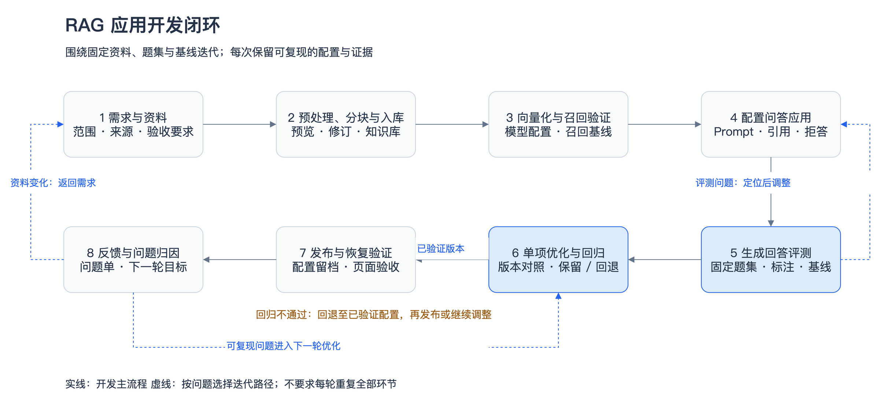

# RAG Workflow Lab

面向工程师的 RAG 开发参考：从资料处理、向量化、检索和生成评测，到优化回归、发布恢复与反馈回流。

**适用范围：随仓脚本仅支持本机 Dify 与 Ollama，不能直接连接共享服务器或统一模型网关。** 文档中的流程可复用到其他部署环境；当前代码没有通用远程 Provider Adapter，仓库也不包含 Dify 服务或模型权重。



图源：[rag-workflow.drawio](docs/diagrams/rag-workflow.drawio)。

## 从哪里开始

- **照着实施**：[八环节开发 SOP](docs/sop/README.md)，每篇只说明输入、步骤、产物和完成条件。
- **复制填写**：[题集、人工标注与发布模板](templates/README.md)。题集模板是填写参考，当前采集入口仍固定使用仓库中的开发题集。
- **运行脚本**：[脚本说明](scripts/README.md)，含 PyCharm、命令参数与真实调用范围。
- **查看案例**：[实验记录索引](docs/records/README.md)，保存公开算法语料的操作过程、成绩、失败及回退证据。

## 本地快速开始

需要 Python ≥3.11，以及已运行的本机 Dify 和 Ollama。Embedding 演示使用 `bge-m3:latest`（1024 维）；本机实验的具体版本与配置见[环境记录](docs/records/本地生成模型接入.md)。Python 脚本仅依赖标准库。

```shell
python3 -m venv .venv
cp .env.example .env

# 真实调用本机 Ollama；不含自动切块、数据库或生成回答
.venv/bin/python scripts/demo_vector_search.py
```

Dify 评测前在本地 `.env` 填写实例自己的知识库／文档 ID、知识库 Key 与应用 Key，并按 [应用配置 SOP](docs/sop/04-应用配置与问答.md) 准备应用。不要复制历史记录中的实例 ID。

```shell
# 真实 Dify 检索；当前限定仓库的栈章节与来源标注
.venv/bin/python scripts/evaluate_dify_retrieval.py --method hybrid --semantic-weight 0.7

# 真实 Dify 生成；采集后仍需人工填写新运行目录的 review.csv
.venv/bin/python scripts/evaluate_dify_generation.py

# 确定性契约测试，不调用模型
.venv/bin/python -m unittest discover -s tests -v
```

完整环境准备、分块和 ID 校准见 [SOP](docs/sop/README.md)。PyCharm 打开项目根目录，解释器选择 `.venv/bin/python`，运行入口位于 `scripts/`。

## 复用边界

更换 Embedding 模型或向量生成规则后，应重建文档向量与索引；仅改变调用路径时，先验证实际模型和输出兼容性，再决定是否重建。迁移后重新测基线，不能直接沿用历史成绩。

自动语义评判尚未实现。现有脚本采集真实回答并汇总人工标注；批量自动评判需先用人工结果校准，见[生成评测 SOP](docs/sop/05-生成评测.md)。

示例语料为《Hello 算法》，不代表真实 IT 知识库验收。表格、截图、操作步骤及按系统版本分支的处理规则，待获得真实 IT 文档并验证后再补充，不将当前算法分块策略写成通用标准。

## 目录与运行证据

```text
├── docs/sop/          # 通用操作步骤，每环节一篇
├── docs/records/      # 本次实验记录、结果、历史执行计划
├── docs/diagrams/     # drawio 源图与 PNG
├── docs/screenshots/  # 过程截图及公开检查说明
├── templates/         # 题集、人工标注与发布记录模板
├── scripts/           # 本机实验入口
├── src/rag_lab/       # 调用、编排与评分逻辑
├── tests/             # 确定性契约测试
├── data/              # 公开语料、来源许可与开发题集
├── runs/              # 真实请求／响应、标注与运行证据
├── releases/          # 实验版本 DSL 与导出信息
└── archive/           # 不参与当前实验的历史资料
```

`runs/` 的真实调用、人工判断与确定性测试分别解释；接口成功不等于答案正确。实验结果与已知问题见[记录索引](docs/records/README.md)。API 响应和保存消息不等于完整 Provider Trace。

`.env`、虚拟环境和 IDE 配置已忽略，密钥不入库。分享运行结果前，检查正文、账户、截图和日志中是否包含非公开信息。

## 许可

自有代码采用 [MIT License](LICENSE)。中文《Hello 算法》来源、固定版本及哈希见 [sources.json](data/knowledge/hello-algo-v0/sources.json)，资料及派生产物遵守 [CC BY-NC-SA 4.0](data/knowledge/hello-algo-v0/LICENSE)。归档 GNOME 资料保留[原许可声明](archive/gnome-v0/knowledge/raw/legal.xml)。第三方资料及包含这些资料的实验输出不因根目录 MIT 许可证而重新授权，Dify 许可证另行适用。
