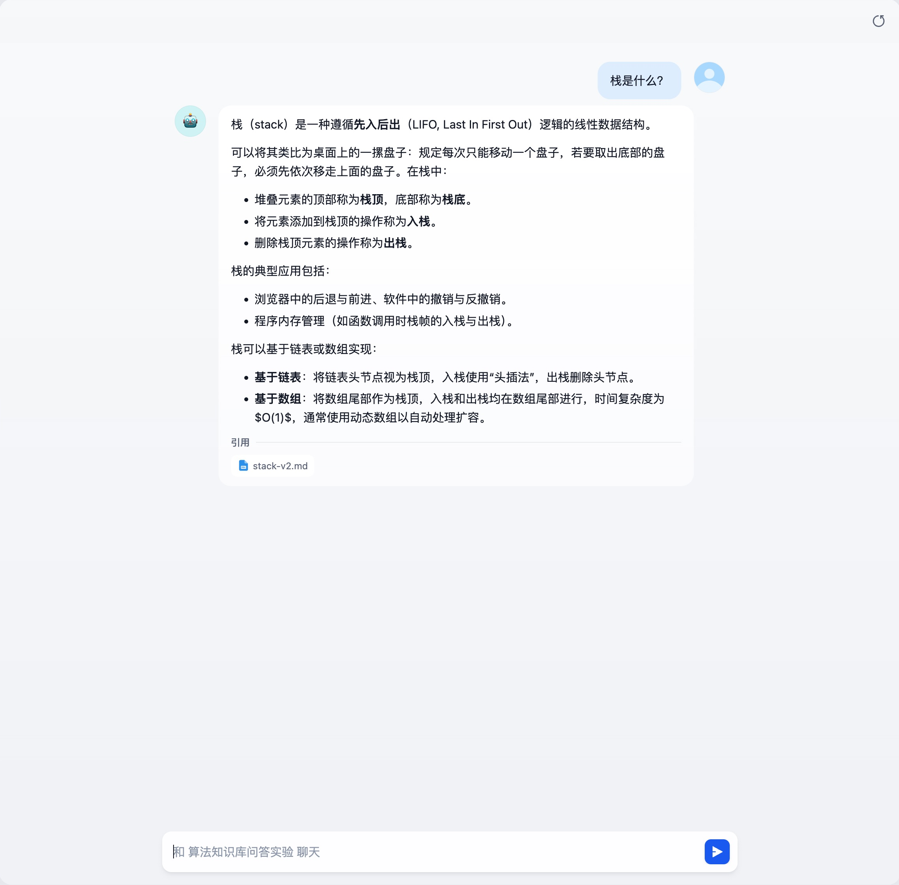
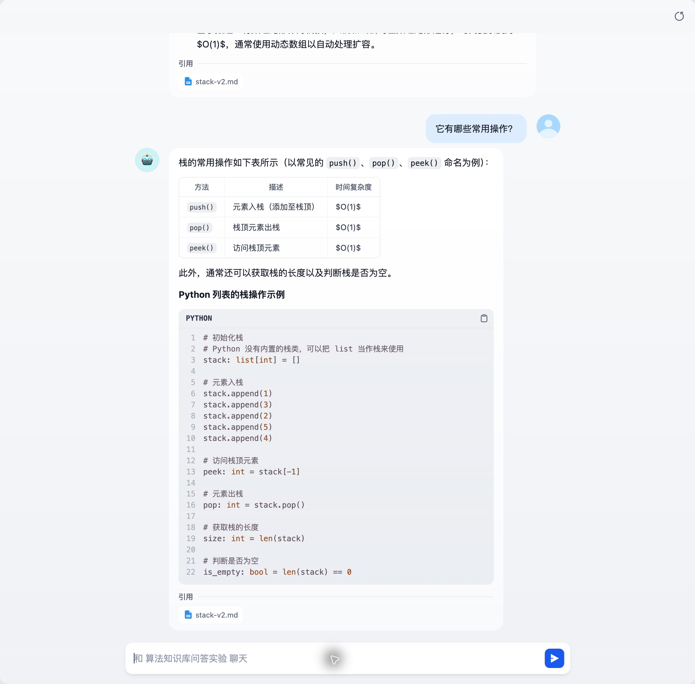

# Dify 多轮对话支持与验证

> 实验记录：保留本轮操作、观察与结果，不作为通用操作入口。通用步骤见 [开发 SOP](../sop/README.md)。

## 当前应用支持到哪里

当前“算法知识库问答实验”为聊天助手，支持在同一会话中连续提问。2026-10-16 已使用本地 Ollama 真实运行一组两轮问答；没有修改应用配置、Prompt 或检索参数。

这里需要区分三层能力：

| 层次 | 当前判断 | 边界 |
|---|---|---|
| 会话历史 | 支持 | 同一 conversation_id 的历史消息可进入生成 Prompt；上下文有限，会截断历史 |
| 追问生成 | 本次简单指代成功 | “它”延续为“栈”；只有一组样本，不能证明复杂多轮稳定 |
| 结合历史检索 | 未见当前路径自动改写问题 | 检索仍接收本轮 query；有记忆不等于检索能理解省略问题 |

网页中不点击“开启新对话”即可继续追问；新会话不应依赖上一个会话的历史。将来使用 API 时，后续轮次需要沿用接口返回的 `conversation_id` 和同一调用用户，不能每轮创建空会话。本轮未执行 API 多轮接入。

## 真实验证：multiturn-smoke-v0

继续使用 `grounded-rag-v1`、`stack-v2.md` 六段知识库及混合检索 0.7／0.3、Top K=3、阈值关闭。模型为 `qwen38-ms-8bit:latest`，后台日志已核对模型名；本机 `/api/tags` 核对的 digest 记录在[运行配置](../../runs/dify-multiturn-20261016/config.json)。这是新增的开发检查，不并入此前 S01–S04 单轮成绩。

| 轮次 | 实际问题 | 预期与观察 | 后台展示 |
|---|---|---|---|
| 1 | 栈是什么？ | 回答线性数据结构、先入后出；核心定义正确 | 88.00 秒，867 Token |
| 2 | 它有哪些常用操作？ | 明确回答“栈的常用操作”，列出 push、pop、peek，并补充长度和判空、Python 示例 | 68.26 秒，1,348 Token |

后台两条记录属于同一会话 `b21621d6-ada9-4a7b-b567-8ef5301e3ae4`；时间分别为 2026-10-16 10:04:13、10:06:08。耗时为 Dify Pipeline 计时间隔，Token 是输入与输出合计，不能用于计算纯模型生成速度。本轮没有首 Token 或各阶段耗时，无法据此归因于模型、检索或其他处理阶段。

[运行证据](../../runs/dify-multiturn-20261016/README.md)保留两轮页面文本及后台记录。截图只覆盖当时可见区域，完整渲染文本以对应 `*-ui.txt` 为准；未采集 Provider 原始 HTTP 响应或第二轮完整 Prompt。

本次结论仅为“一组简单两轮连续追问可用”。知识库当前只有栈主题，即使省略主题仍可能检索到栈资料；没有无历史对照，不能把本次答对完全归因于历史记忆，也不能证明多主题知识库下的追问召回质量。

还观察到回答把数组尾部入栈概括为 O(1)，未保留动态数组扩容的单次开销；第二轮操作表与资料中的表格一致，但不据此认定所有实现、所有单次操作都为 O(1)。这与已有复杂度表述问题一致，本轮先记录，不调 Prompt。

## 源码如何实现

以下路径相对于 Dify 源码根目录，核查 checkout 为 `1.13.0`，未修改源码。

1. `api/core/app/apps/chat/app_runner.py`：存在 `conversation_id` 时创建 `TokenBufferMemory`，组装 Prompt 时传入 memory。
2. `api/core/prompt/simple_prompt_transform.py`：聊天模型的简单 Prompt 顺序为 SYSTEM → 可容纳的历史消息 → 当前 USER。
3. `api/core/memory/token_buffer_memory.py`：读取同一会话消息；按 Token 限制移除较早消息。这里的 memory 是会话上下文，不是模型训练，也不是跨会话长期记忆。
4. `api/core/rag/retrieval/dataset_retrieval.py`：`retrieve()` 虽接收 `memory` 参数，但核查的该路径未利用它改写 query，单路／多路检索仍传入本轮 query。仅凭函数有 memory 参数不能判断已完成多轮问题改写。

因此后续若发现“它怎么配置”“那另一个呢”等追问召回不准，应先检查检索 query 是否完整。是否增加结合历史的问题改写，要在出现失败样本后讨论，不在本轮直接改造。

## 页面体验记录与处理方向

用户反馈当前日志页面不友好，本轮保留两个不同使用场景的问题：

- 调试页面：Prompt 长文本放在窄弹层中，SYSTEM、历史、检索片段的关系不容易阅读。当前继续将每次实验整理为可读文档，保留原始证据；不为本轮实验修改 Dify 前端。
- 员工问答页面：第二轮截图中的 `$O(1)$` 没有渲染成公式；简单提问附带较长代码，增加阅读负担。回答长度可作为后续 Prompt 单项优化，公式显示属于展示问题，分别记录与验证。
- 响应体验：本组后台显示 88.00／68.26 秒，交互等待明显；在扩大试用前需要单独衡量首 Token 与总耗时。本轮不因两次数据建立性能基线，也不擅自换模型。

建议本阶段继续使用 Dify 自带网页完成验证；正式员工入口后续通过 API 接入服务台，再设计适合业务的回答和引用展示。当前没有确定或实施新的前端项目。

## 下一步

先与用户共同确定生成评测规则，覆盖核心正确、来源支持、适用条件、拒答和连续追问。多轮后续按具体失败需要补充指代、主题切换与历史错误传播样本；不在本轮自动扩大测试集或添加改写节点。

## 历史慢请求定位（2026-10-16）

本次只读查询已有数据库和服务日志，未重跑模型、未改配置。结论：**两轮主要耗时集中在本地生成模型服务；第一轮还包含约 27.2 秒的 MLX runner 冷启动。当前没有完整分布式 Trace。**

| 计时位置 | 第一轮 | 第二轮 |
|---|---|---|
| Dify 消息 Pipeline | 88.00 秒 | 68.26 秒 |
| Embedding 插件调用 | 1.938 秒 | 4.123 秒 |
| LLM 插件调用 | 85.820 秒 | 57.890 秒 |
| MLX runner 启动到 ready | 约 27.207 秒 | 本轮调用前已 ready，未见重新启动 |
| MLX `/v1/completions` 请求 | 58.545 秒 | 57.810 秒 |

表内计时存在包含关系：MLX 启动与模型处理位于 LLM 调用链内，不能将所有行相加。第一轮 LLM 插件时长约占 Pipeline 的 97.5%，第二轮约占 84.8%；这些是时间窗口关联后的定位依据，不是独立 Span 占比统计。

### 已确认的证据

- 第一轮 Ollama 日志在 10:04:14.795 启动 `qwen38-ms-8bit:latest` 的 MLX runner，10:04:42.002 标记 ready，间隔约 27.207 秒。随后内部 `/v1/completions` 请求用了 58.545 秒，外层 `/api/chat` 在 10:05:40 完成，与 LLM 插件调用结束时间吻合。
- 第二轮在 10:06:18.471 开始记录输入处理，内部请求于 10:07:16 完成，用时 57.810 秒；Ollama `/api/chat` 为 57.858 秒，与插件 57.890 秒接近。慢主要发生在模型服务内部，不能只归因于 Dify 页面或插件转发。
- 第一轮 Prompt 为 639 Token、输出 228 Token；第二轮为 1,085／263 Token。数据库存储值与模型日志中的输入数量吻合。
- Prompt progress 日志与请求结束之间还有较长间隔，但 progress 不是精确的 prefill 完成或首 Token 事件，不能据此精确拆出输入处理和逐 Token 生成耗时，也不能拿总请求时间算纯生成速度。

### 没有完整 Trace 的依据

API 容器 `ENABLE_OTEL=false`；当前应用的 `apps.tracing` 为空，`trace_app_config` 无配置；两条消息没有 `message_chains` 记录。插件 HTTP 日志各自有 trace_id，但没有已验证的统一链路 ID 将网页、检索、Embedding、LLM、MLX 的事件串起来。

因此本次是按时间窗口、完成时刻、输入 Token 数拼接的历史证据。它足以定位主要耗时服务及第一轮冷启动，尚不能还原精确首 Token 延迟、向量查询／重排耗时、模型加载／输入计算／输出生成的完整分解。第二轮未被以上嵌套计时覆盖的时间保持未归因，不能直接叫作“检索耗时”。

同一时间窗口还出现另一次 1.428 秒的 LLM 插件调用及 HTTP 402 余额错误；尚无关联证据表明它是主回答请求，不将其作为本次慢请求原因。主回答本地调用完成并已留存输出。

### 留存文件与下一步

[诊断数据](../../runs/dify-multiturn-20261016/latency-investigation.json)、[插件时长](../../runs/dify-multiturn-20261016/plugin-timings.json)、[Ollama 计时摘录](../../runs/dify-multiturn-20261016/ollama-timing-excerpts.log)保留本次证据。插件摘录只保存时刻、调用类型、时长和 trace_id，排除账户、客户端地址及请求凭据。

如需继续定位模型内部原因，下一步在相同模型与输入下采集一次冷／热调用的 Ollama 原始计时字段和流式首 Token 时间，再判断输入处理、生成或加载分别占多少。完整 RAG Trace 的启用方案仍属独立观测任务，本次未启用采集平台、未修改 Dify 源码，也未调整模型。
