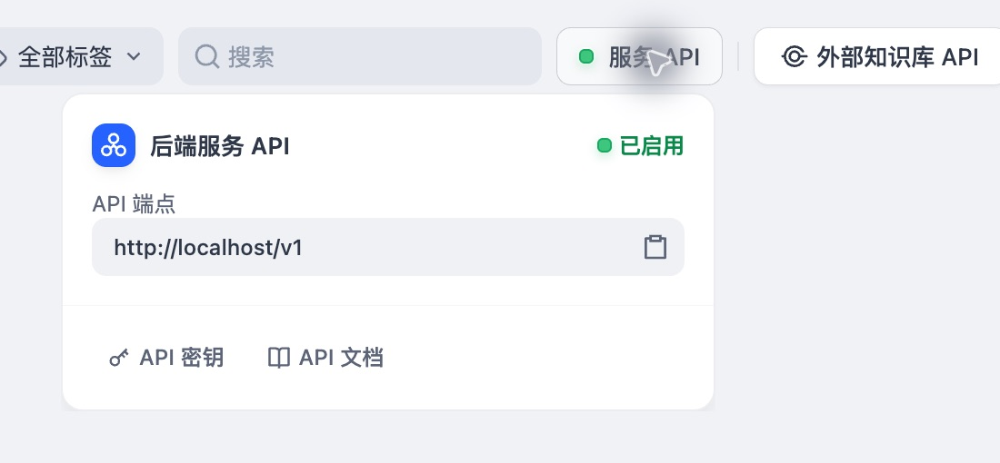

# 召回测试记录

> 实验记录：保留本轮操作、观察与结果，不作为通用操作入口。通用步骤见 [开发 SOP](../sop/README.md)。

## 向量检索基线（2026-10-15）

范围为单篇 `stack-v2.md` 的 6 个分段。测试前将问题、预期分段及答案依据保存为 [stack-retrieval-v0](../../data/evaluation/stack-retrieval-v0.json)，这是开发小样本，不是冻结验收集；原有六篇摘录题集对应不同语料，不能直接复用其成绩。

通过 Dify 的“召回测试”实际执行检索：Ollama `bge-m3:latest`，向量检索、Top K = 3、Rerank 关闭、Score 阈值关闭。配置截图见 [检索设置](../screenshots/20261015-retrieval-settings.png)。文档处理参数见 [导入记录](../../data/knowledge/hello-algo-v0/import/README.md)。本轮未修改检索配置，未调用生成模型。

| 测试题 | 预期分段 | 实际 Top 3：分段 / 页面分数 | 预期排名 |
|---|---|---|---|
| S01 后放进去的东西反而先取出来，这属于什么结构？ | 01 栈定义 | 01 / 0.62；03 / 0.56；04 / 0.50 | 1 |
| S02 Python 用列表作为栈时，如何查看栈顶、弹出元素并判断是否为空？ | 02 常用操作 | 01 / 0.65；02 / 0.64；03 / 0.64 | 2 |
| S03 数组实现的栈为什么有时入栈会变慢？链表实现会遇到同样的问题吗？ | 04 实现对比 | 04 / 0.79；03 / 0.72；01 / 0.62 | 1 |
| S04 快速排序如何选择基准元素？ | 无答案 | 01 / 0.47；03 / 0.47；02 / 0.43 | 不计入命中率 |

有答案题 Hit@1 = 2/3，Hit@3 = 3/3。这里 Hit@K 表示预先指定的答案分段是否出现在前 K 条。S01 的分段 03 也提到先入后出，不影响本次以定义分段 01 为目标的结果。S02 的 Top 1 仅解释栈的概念，不能覆盖问题要求的 Python 操作；分段 02 包含全部代码依据，排名第 2。该题是下一轮对比的观察点，尚不能归因于具体模型或分块缺陷。

S04 在资料不含答案时仍返回 3 个近邻，符合阈值关闭的检索行为。页面分数不是回答正确的概率，不能凭这 4 题直接设定拒答阈值。只有 6 块且 Top K = 3，命中结果不代表大规模知识库效果。

本轮完成真实 Embedding 检索链路的页面验证与小样本基线；未验证生成回答、引用正确性及拒答能力。未额外采集 Provider 原始请求/向量或服务端 Trace，未测量检索延迟；保留的是实际返回分段的页面文本、展示分数及截图。分数保留页面两位小数，实际排序以页面顺序为准。

证据：[结构化结果](../../runs/stack-retrieval-v0/results.json)、[页面文本](../../runs/stack-retrieval-v0)、[S01](../screenshots/20261015-retrieval-S01.png)、[S02](../screenshots/20261015-retrieval-S02.png)、[S03](../screenshots/20261015-retrieval-S03.png)、[S04](../screenshots/20261015-retrieval-S04.png)。

下一轮沿用同一语料、同一题集及 Top K，对比混合检索。先核对混合检索的融合方式与模型要求，再记录参数；不能根据本轮结果提前认定混合检索更优。该轮结束时尚未切换，后续对比见下一节。


## 混合检索对比（2026-10-15）

沿用同一篇导入稿、6 个分段及 `stack-retrieval-v0` 四题，未重分块、未调整问题或预期答案。召回测试页面切换到混合检索，选择默认“权重设置”：语义 0.7、关键词 0.3，Top K = 3，Score 阈值关闭；不配置额外 Rerank 模型。选择权重融合是为了先测试页面现有配置，避免同时引入重排序模型这一变量；本轮未调权重。截图见 [混合检索设置](../screenshots/20261015-hybrid-settings.png)。这里只记录页面配置与实际返回，不声称已经核查底层融合公式、分词器或每一路候选集。

| 题目 | 向量检索预期排名 | 混合检索预期排名 | 混合 Top 3：分段 / 页面分数 |
|---|---|---|---|
| S01 栈的先入后出 | 1 | 1 | 01 / 0.48；03 / 0.39；04 / 0.35 |
| S02 Python 栈操作 | 2 | 1 | 02 / 0.54；03 / 0.48；01 / 0.47 |
| S03 数组扩容与链表对比 | 1 | 1 | 04 / 0.61；03 / 0.58；01 / 0.45 |
| S04 快速排序，无答案 | 不计分 | 不计分 | 01 / 0.36；03 / 0.36；02 / 0.33 |

有答案题 Hit@1 从 2/3 变为 3/3，Hit@3 保持 3/3。S02 的正确分段由第 2 升至第 1，另两题目标排名未退步。本轮只能确认这组配置在这 3 道有答案题上的表现，不能推出混合检索普遍更优，也未通过扩大题集或独立验收集验证稳定性。

无答案题仍召回 3 段，未实现自动拒答。向量分数和混合分数的计算口径不同，不能将分数下降解释为质量下降，也不能直接沿用同一个阈值。暂不根据本轮分数设置阈值。

召回测试页面当前显示混合检索；这不作为关联应用已经采用同一配置的证明，应用接入时应另行核对检索节点。本轮未创建问答应用、未调用生成模型或验证答案生成。检索经过真实的 Dify 检索链路，但没有单独采集 Provider 原始请求、缓存命中或服务端 Trace，不能据页面结果判断每题是否重新执行了模型推理。

证据：[结构化结果](../../runs/stack-hybrid-v0/results.json)、[页面返回文本](../../runs/stack-hybrid-v0)、[S01](../screenshots/20261015-hybrid-S01.png)、[S02](../screenshots/20261015-hybrid-S02.png)、[S03](../screenshots/20261015-hybrid-S03.png)、[S04](../screenshots/20261015-hybrid-S04.png)。模型与分数精度限制沿用上一轮说明。

阶段结论：保留两轮基线，混合检索可作为下一步问答试验的候选配置。下一步先确认生成模型可用，再创建最小知识库问答应用，验证“检索 → 依据资料回答 → 引用来源 → 证据不足时拒答”；不在本轮扩展题集或调参。


## 检索配置决策与迭代方法

本节为后续实验方法，不代表已执行新的权重测试或已经确定上线验收标准。

### 权重选择依据

语义检索用于匹配同义表达、口语和省略术语的问题；关键词检索用于匹配错误码、命令、产品名及版本等具体词语。权重控制两路评分融合时的相对影响，不代表结果条数的分配，也不是正确概率。关键词匹配的效果还受分词与索引实现影响，不能仅凭权重推断精确词一定命中。

当前采用语义 0.7、关键词 0.3，仅因为它是页面默认配置，且本轮小样本观察到代码题排名改善；这不是最优权重的证明。未来 IT 数据含大量精确词，增加关键词权重值得验证，但属于待验证假设。后续先比较 0.7/0.3、0.5/0.5、0.3/0.7 三组，不进行大规模穷举。

### 测试与调优循环

1. 固定语料版本与题集，测试前标注答案证据、问题类型和有无答案。至少覆盖语义改写、精确词、版本或系统相似的干扰题、无答案题；需要多段资料才能回答的问题应标注全部必要证据。证据关联原文，分段 ID 只用于本轮索引定位。
2. 区分开发集与独立验收集。开发集用于反复分析和调参；验收集留到候选配置确定后使用。当前四题属于开发样本，不能同时充当最终验收证据。
3. 固定模型、分块、Top K、阈值及其他检索设置，每轮只改变权重这一主要因素。先比较少量候选；只有具体失败样本支持继续调整，才做局部细调。后续再分别比较 Top K、Rerank 和阈值，避免一次改变多个因素。
4. 对同一批题执行真实检索，记录配置版本、返回分段及证据、排名、分数、失败和延迟。分数只在相同计算口径下解释；不能用平均分数上升代替质量改善。记录缓存状态（若可获取），不要将缓存请求耗时直接当成模型推理耗时。
5. 比较整体指标和各类问题的指标，逐项查看新增命中与退步样本。多类题比例不同会影响总分，应同时报告每类题的数量和成绩；不能用精确词题提升掩盖语义题或关键业务场景退步。
6. 确定候选后在独立验收集复验，满足预先约定的质量与延迟要求才冻结配置。若根据验收失败继续调参，该题就已参与开发，后续需保留新的独立验收证据。没有明确问题或收益时停止调优，不为追逐更高分无限循环。

“多轮调优”是带着失败原因改变配置再对比，不是原样重复运行直到成绩好看。重复运行主要用于检查波动或测量延迟；出现不稳定时才需要增加重复次数。文档、模型、分块或问题分布发生实质变化后，重新回归评测；阈值在选定检索方式和权重后另行校准。

### 评估指标与计算口径

以下指标分母须明确。有答案题与无答案题分开统计，不把无答案题计入 Hit@K 的分母。

| 指标 | 计算口径 | 用途与限制 |
|---|---|---|
| Hit@1 / Hit@K | 有答案题中，前 1 / K 条至少包含一处正确答案证据的题数 ÷ 有答案题总数 | 看能否找到及是否排在首位；多证据问题命中一处不等于足以回答 |
| Recall@K / 必要证据完整率 | 每题前 K 条覆盖的标注证据数 ÷ 全部标注证据数，再对有答案题取平均；完整率为全部必要证据均召回的题数 ÷ 有答案题总数 | 多段或多文档回答重点使用；要求证据标注充分，并对重叠或重复块按证据去重 |
| MRR@K | 对有答案题，首个相关结果排名 r 在 K 内记 1/r，未命中记 0，再取平均 | 衡量排序；不衡量后续证据是否齐全。单一目标时与 Hit 指标互补 |
| Precision@K | 每题前 K 条中相关结果数 ÷ K，再对有答案题取平均；少于 K 条按缺位不相关计，并记录实际条数 | 看无关上下文占比；需标注所有候选的相关性，不能只认唯一目标块。该固定 K 口径不是仅按实际返回条数计算的精确率 |
| 阈值误过滤率 / 无答案放行率 | 有答案题中，阈值过滤后不再保有所需答案证据的题数 ÷ 有答案题总数；无答案题中过滤后仍有候选的题数 ÷ 无答案题总数 | 用于阈值校准；无答案放行仅代表有候选进入后续环节，不代表 LLM 已错误回答 |
| 检索延迟与失败率 | 请求开始至完整检索结果返回的端到端耗时，报告样本数及 P50/P95；失败请求数 ÷ 请求总数 | 计入问题向量化、搜索和融合/重排序；区分冷启动与缓存。失败不能从命中率中静默剔除 |

本轮单篇实验以 Hit@1、Hit@3 和逐题排名为主。既有数据也可推导 MRR@3：向量检索为 `(1 + 1/2 + 1)/3 ≈ 0.833`，混合检索为 1；这是对已有结果的计算，没有新增检索调用。未标注全部候选相关性，暂不报告 Precision@3；未做多证据标注、阈值实验及端到端计时，暂不报告相应指标。

配置选择优先保证必要证据召回和关键题型不退步，再比较排序与无关内容，最后检查延迟是否满足使用要求。可接受的退步幅度、最低命中率和延迟目标需要结合业务风险预先约定，当前尚未确定；不以这三道有答案题的 100% 作为正式上线门槛。

### Hit@1 与 MRR 的含义和本轮计算

相关性由测试前标注的答案证据决定，不由相似度分数或 LLM 最终回答决定。当前脚本使用已核对的目标文档与目标分段定位证据；它不自动判断正文事实是否正确。

**Hit@1** 衡量有答案题中，第一条检索结果命中标注证据的比例。每题命中记 1，否则记 0，再取平均。

**MRR（Mean Reciprocal Rank，平均倒数排名）** 衡量首个相关结果的排序位置：每题取首个相关结果排名的倒数，再取平均。本项目只检查前 3 条，因此使用截断指标 **MRR@3**；前 3 条未命中记 0。MRR 的范围为 0–1，不是答案正确的概率。

| 首个正确结果位置 | Hit@1 每题得分 | MRR@3 每题得分 |
|---|---|---|
| 第 1 | 1 | 1 |
| 第 2 | 0 | 1/2 |
| 第 3 | 0 | 1/3 |
| 前 3 条未找到 | 0 | 0 |

本轮向量检索三道有答案题的目标排名为 `1、2、1`：

- Hit@1 = `(1 + 0 + 1) / 3 = 2/3 ≈ 66.7%`。
- MRR@3 = `(1 + 1/2 + 1) / 3 ≈ 0.8333`。
- 混合检索目标排名为 `1、1、1`，两项指标均为 1；仅代表这三题的检索表现。

Hit@1 直接检查首位命中，MRR@3 能体现第二名优于第三名的排序差异。两者都只关注首个正确结果，无法证明多证据问题所需资料已经找全；这种情况还要看必要证据完整率。无答案题没有正确结果的预期排名，本项目将其单独观察，不放入这两个指标的分母。

### 召回评估在项目中的作用

RAG 的检索阶段负责为 LLM 提供资料，生成阶段负责依据资料组织答案。召回评估的目的，是验证正确资料能否进入生成上下文，并为失败定位提供依据。

- **检索失败**：答案证据未进入返回结果，优先检查资料覆盖、解析与分块、模型及检索配置。单纯修改生成 Prompt 无法恢复没有检索到的依据。
- **生成失败**：返回资料已包含充分证据，但回答遗漏条件、理解错误或编造，优先检查 Prompt、上下文组织及生成模型。
- **组合失败**：结果中只有部分证据，或掺杂版本不同的相似资料，同时造成回答偏差；需要结合完整检索结果和生成输出分析，不能仅凭命中一个分段认定检索没有问题。

本轮 Python 操作题的正确分段从第 2 升至第 1，证明这道题的资料排序改善。由于两轮 Top 3 都包含它，如果最终都将三段交给 LLM，生成答案可能相同；是否因此提高回答质量，尚需端到端测试。不能将 Hit@1 或 MRR 的提升直接换算为答案正确率提升。

这一步产出的是可复现的检索基线和定位依据，支持后续配置取舍。最终验收仍以完整问答为对象：答案正确且完整、结论有资料支持、引用可信，以及证据不足时能够追问、拒答或转人工。若检索指标改善但最终问答没有收益，需结合延迟与实际需求重新判断是否保留配置。

### 与问答评估的边界

召回评估回答“资料是否找到、证据是否足够”；完整问答还需单独评估答案正确与完整、是否忠于检索证据、引用是否支持结论，以及无答案题的正确拒答率、有答案题的误拒答率。无答案题有检索结果但最终正确拒答，并不算问答失败；召回正确但 LLM 编造答案，仍是问答失败。

每轮沿用现有记录方式：输入与题集版本、配置、逐题结果、汇总指标、新增失败和退步、采用或保留原配置的理由，另附关键截图。保留足够复现的证据即可，不要求每次另建一套报告。


## 自动评测脚本接入状态（2026-10-15）

已提供 [evaluate_dify_retrieval.py](../../scripts/evaluate_dify_retrieval.py)，通过知识库 Service API `/v1/datasets/{dataset_id}/retrieve` 执行真实检索，支持本轮向量与权重混合配置；运行说明见 [Dify 召回自动评分](../../scripts/README.md#dify-召回自动评分)。只读核对的源码位置为 Dify 源码仓库 `api/controllers/service_api/dataset/hit_testing.py`、`api/controllers/console/datasets/hit_testing_base.py`、`api/services/hit_testing_service.py` 和 `api/fields/hit_testing_fields.py`。脚本复用现有四题，以指定文档和分段位置计算命中，答案锚点用于运行前核对，不用关键词规则替代检索。

确定性验证：3 个评分契约测试通过，CLI 帮助及缺失配置提示已检查，`.env` 确认被 Git 忽略。真实 API 自测：本节初次记录时尚未执行成功，当时缺知识库 API Key；用户随后已配置，见下一节。已有页面实测成绩继续有效，但不能作为新脚本已经通过真实调用的证据；需补齐 Key 后运行向量与混合两轮，留存原始响应并与页面排名对照。当前未提交 Git。


## API 密钥与本地配置记录（2026-10-15）

已在实际页面核对本机版本的入口：顶部“知识库”进入列表 → 右上角“服务 API” → “API 密钥” → “创建密钥”。单个知识库左下角“访问 API”仅显示服务访问开关及 API 文档链接；此前将其描述为密钥管理入口不准确，运行说明已修正。这里使用知识库服务 API Key，不是应用 API Key，也不是 Embedding 或生成模型的供应商密钥。



图中是实际操作页面裁剪，保留“服务 API”、本机端点 `http://localhost/v1` 和“API 密钥”入口。密钥管理弹窗可能显示密钥片段，因此先关闭弹窗再截图；未保存密钥列表、密钥值或 `.env` 编辑器画面，并裁掉浏览器外壳及个人名称。该截图证明入口位置，不证明密钥调用成功。

已完成密钥创建并写入项目根目录 `.env`。本轮仅检查四个字段非空：`DIFY_API_BASE`、`DIFY_API_KEY`、`DIFY_DATASET_ID`、`DIFY_DOCUMENT_ID`，未打印字段值；`git check-ignore .env` 确认本地配置文件被 Git 忽略。公开示例只保留占位符：

```dotenv
DIFY_API_BASE=http://localhost/v1
DIFY_API_KEY=<仅在本地填写>
DIFY_DATASET_ID=<当前知识库 ID>
DIFY_DOCUMENT_ID=<当前文档 ID>
```

配置文件名为 `.env`，不是 `env`；也可在 PyCharm Run Configuration 中配置同名环境变量，环境变量优先。检查非空只说明配置已填写，不能证明 Key 有效或 ID 正确。本轮补截图和文档，未运行自动评测；下一步运行脚本进行真实 API 验证。


## 自动评测真实 API 验证（2026-10-15）

配置完成后，实际运行以下两轮：

```shell
.venv/bin/python scripts/evaluate_dify_retrieval.py --method vector
.venv/bin/python scripts/evaluate_dify_retrieval.py --method hybrid
```

两轮预检均通过：本地导入稿哈希符合题集版本，知识库返回模型为 `bge-m3:latest`，远端目标文档为 6 个分段，预标注段身份、启用状态与答案锚点符合要求；每题检索返回的目标文档分段与本轮快照一致。请求明确指定检索参数，不改变知识库持久配置。

| 配置 | 有答案题目标排名 S01/S02/S03 | Hit@1 | Hit@3 | MRR@3 | 请求失败 |
|---|---|---|---|---|---|
| 向量，Top K=3，阈值关闭 | 1 / 2 / 1 | 2/3 | 3/3 | 0.8333 | 0/4 |
| 混合，语义 0.7 / 关键词 0.3，Top K=3，阈值关闭 | 1 / 1 / 1 | 3/3 | 3/3 | 1.0 | 0/4 |

程序逐题核对：两轮所有题的目标排名、Top 3 分段顺序及四舍五入到两位小数的分数，均与对应页面基线一致。S04 为无答案观察题，两种配置仍各返回 3 段，不参与命中率和 MRR 分母；未验证拒答能力。

向量轮客户端端到端耗时为 1.7463、0.1483、0.1398、0.1399 秒（以原始记录为准），混合轮约 0.11–0.13 秒。只有每轮 4 个请求，且未采集缓存、模型加载和服务端 Trace，因此不据此比较两种检索方式的性能，不宣称每个请求均重新执行模型推理。

真实调用证据：

- [向量运行目录](../../runs/dify-retrieval-20261015-173202-072523)：配置、题集与分段快照、S01–S04 原始请求/响应、日志和 [评分汇总](../../runs/dify-retrieval-20261015-173202-072523/summary.json)。
- [混合运行目录](../../runs/dify-retrieval-20261015-173222-555849)：同类产物及 [评分汇总](../../runs/dify-retrieval-20261015-173222-555849/summary.json)。

本轮新增证据是 API 原始响应与代码日志，无需用截图替代原始结果。API Key 不写入请求产物或日志，已检查这两轮产物未包含本地密钥值。

验证结论分开记录：确定性评分契约此前 3 项测试通过；本轮真实 Dify API 检索与自动评分成功，并复现手工页面基线。生成模型问答、引用、拒答和扩大语料后的效果均未验收。当前四题仅作为开发回归样本，未确定正式效果门槛。

下一步在项目组逐步确认的节奏下，先检查生成模型可用性，再搭建最小知识库问答应用；不在本轮自动扩大题集或继续权重调参。
