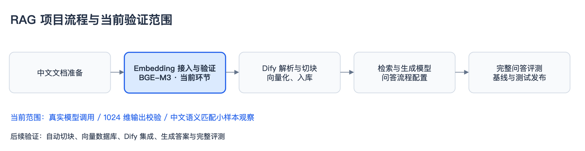
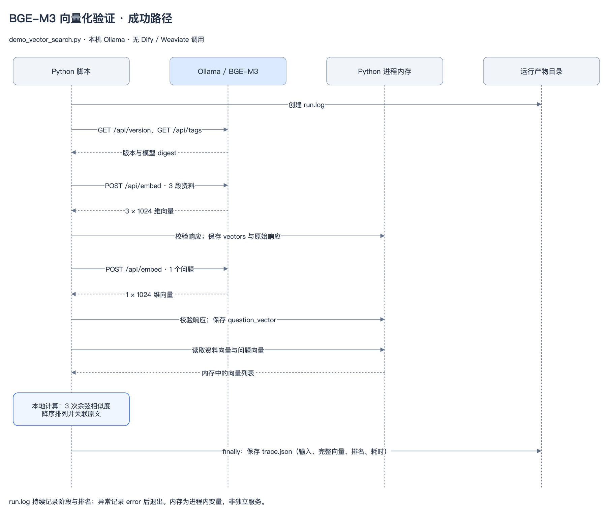
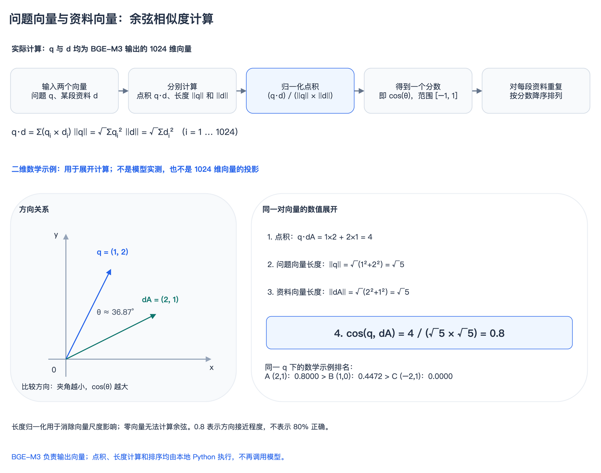

# BGE-M3 接入与向量化验证

## 1. 项目定位

本环节验证本机 BGE-M3 的调用链路、中文输入的向量输出契约及小样本语义匹配表现，为后续 Dify 知识库接入提供依据。



图源：[bge-m3-project-flow.drawio](diagrams/bge-m3-project-flow.drawio)。蓝色节点为当前验证环节。

模型下载、模型调用、检索质量和完整 RAG 效果分别验证。模型文件存在不代表接口可用；接口可用不代表检索质量达标。

## 2. 实现与验证范围

入口：[demo_vector_search.py](../scripts/demo_vector_search.py)。运行环境为项目 `.venv/bin/python`，仅使用 Python 标准库。

| 项目 | 当前实现 |
|---|---|
| 模型服务 | 本机 Ollama，`http://127.0.0.1:11434` |
| 模型 | `bge-m3:latest`，运行时记录模型 digest |
| 输入 | 3 段中文资料、1 个中文问题 |
| 模型输出 | 每段输入对应 1 个 1024 维稠密向量 |
| 相似度计算 | Python 逐一计算余弦相似度，按分数降序排列 |
| 运行产物 | 原始输入、模型响应、耗时、排名和日志 |

当前只使用稠密向量表示，未验证 BGE-M3 的其他检索表示。脚本不训练或微调模型，也不执行自动切块、向量数据库操作、Dify 调用或生成式回答。

## 3. 输入数据

`DOCUMENTS` 是依据《Hello 算法》整理的教学短句，不是六篇完整 Markdown 的自动切块结果。

| 标题 | 输入正文 |
|---|---|
| 栈 | 栈遵循先入后出规则，后放入的元素先取出。 |
| 队列 | 队列遵循先入先出规则，先进入的元素先取出。 |
| 数组 | 数组把相同类型的元素存放在连续内存中，可以通过索引访问元素。 |

`QUESTION`：

> 后放进去的东西先取出来，应该用什么数据结构？

向量化仅使用 `text` 正文，`title` 用于展示。人工预期为“栈”排名第一，该预期不参与模型请求或排名计算。

## 4. 调用时序



图源：[bge-m3-sequence.drawio](diagrams/bge-m3-sequence.drawio)。图中内存表示 Python 进程内变量，不是独立服务；文件目录表示本地运行产物。图示为成功路径。

调用顺序与脚本一致：

1. 创建运行目录及 `run.log`，读取原始输入。
2. 调用 `GET /api/version` 和 `GET /api/tags`，记录服务版本并确认模型身份。这两次请求不执行推理。
3. 调用 `POST /api/embed`，输入三段资料，返回三个向量。
4. 校验资料向量，保存在进程内存的 `vectors` 中。
5. 再次调用 `POST /api/embed`，输入一个问题，返回一个向量，校验后保存到 `question_vector`。
6. 在本地计算三次余弦相似度，排序并关联原文。
7. 在 `finally` 中写入 `trace.json`。异常路径记录错误并退出，不继续生成排名。

请求契约示例：

```json
{
  "model": "bge-m3:latest",
  "input": ["栈遵循先入后出规则，后放入的元素先取出。"],
  "truncate": false
}
```

资料和问题使用同一模型，不添加其他模型的查询前缀。`truncate: false` 禁止静默截断过长输入。每个 HTTP 请求的超时为 120 秒；脚本不自动下载模型、不重试失败请求。

## 5. 向量表示与存储

Embedding 将文本映射为浮点数组。当前每段输入输出 1024 个数；维度不对应单个汉字，也不直接对应可命名的业务概念。语义接近性来自已训练模型的表示能力，仍可能出现错误匹配。

运行时的数据对应关系：

```text
DOCUMENTS[0] ↔ vectors[0]
DOCUMENTS[1] ↔ vectors[1]
DOCUMENTS[2] ↔ vectors[2]
QUESTION     ↔ question_vector
```

模型响应向量与输入顺序对应，程序依此保留原文关联。展示的前 3 个数仅用于日志预览，相似度计算使用全部 1024 维。

向量计算时驻留在 Python 内存中，运行结束后通过 `trace.json` 保留完整响应。该 JSON 是实验记录，不承担向量索引功能。下一次运行仍重新生成资料向量和问题向量，不读取历史向量。

资料向量与问题向量必须使用兼容的表示空间。同维度不能证明两个模型的向量兼容；更换 Embedding 模型通常需要重建资料向量。

## 6. 相似度与排序



图源：[bge-m3-cosine.drawio](diagrams/bge-m3-cosine.drawio)。上半部分为实际 1024 维计算链路，下半部分为独立的二维数学示例，非模型实测值或高维投影。

示例取问题向量 `q = (1, 2)`、资料向量 `dA = (2, 1)`：点积为 `4`，两个向量长度均为 `√5`，余弦相似度为 `4 / (√5 × √5) = 0.8`。固定 q 后，对各资料分别重复计算，再按分数降序排列。

除以长度乘积消除了正向缩放对分数的影响；比较的是方向，而不是向量的绝对长度。方向越接近，夹角越小，余弦值越大。当前代码按全部 1024 维进行同样的计算。

`cosine()` 计算问题向量 `q` 与资料向量 `d` 的余弦相似度：

```text
cos(q, d) = Σ(qᵢ × dᵢ) / (√Σqᵢ² × √Σdᵢ²)
```

该指标衡量向量方向的接近程度，理论范围为 −1 到 1。分数不表示答案正确概率，也不直接构成可回答性的判定依据。

`ranking.sort(..., reverse=True)` 按分数降序排列。相似度和排序均由 Python 执行，不再调用模型。输出为对应的原始资料，不是新生成的答案。

代码未设置相关性阈值，也未实现拒答。无关问题仍会获得第一名；该结果只表示候选集合内的相对排序。拒答阈值需要结合有答案与无答案评测集另行验证。

## 7. 日志与运行产物

### 7.1 当前运行记录

| 日志阶段 | 记录内容 | 检查项 |
|---|---|---|
| ① 原始输入 | 资料正文与问题 | 输入与本次验证目标一致 |
| ② 资料向量化 | 向量数量、维度和数值预览 | 三段资料分别返回 1024 维向量 |
| ③ 问题向量化 | 问题向量数值预览 | 一个问题返回 1024 维向量 |
| ④ 比较与排名 | 三个相似度分数、排序及首段原文 | 排名与人工预期的符合情况 |

输出目录：`runs/demo-时间戳/`。

- `run.log`：与控制台一致的阶段日志、分数、排序和错误说明。
- `trace.json`：实际输入、模型元数据及 digest、完整向量响应、请求耗时、排名和运行状态。失败时保留错误及已完成阶段的数据。

`status: completed` 表示调用与计算完成，不表示语义质量达标。排名错误不会自动导致程序失败。实际分数与结论须以对应运行记录为依据。

### 7.2 向量化环节的监控指标

以下指标用于判断 Embedding 调用是否稳定、输入是否完整处理、输出是否有效。资料向量化与问题向量化应分别统计；不包含检索排序和回答生成的耗时或效果。

| 指标 | 统计口径与检查项 |
|---|---|
| 成功率与错误 | 请求成功数 / 请求总数；接口错误与输出校验失败分别统计，记录超时、连接失败、输入超限等原因 |
| 调用耗时 | 每次请求从发出到收到完整响应的耗时；积累多个样本后统计 P50/P95，首次模型加载与后续调用分开观察 |
| 吞吐量 | 指定时间窗口内完成的文本条数 / 窗口秒数；Token 吞吐量仅在取得真实 Token 数时计算，并注明批次大小与并发数 |
| 输入情况 | 每批文本条数、各文本 Token 长度、是否允许截断及实际截断情况；字符数不能当作 Token 数 |
| 输出完整性 | 输入 N 条文本是否返回 N 个向量，并保持输入输出顺序对应 |
| 向量有效性 | 维度是否符合模型约定且一致；是否包含 NaN、Inf、零向量等异常输出 |

输入 Token 长度应由模型对应的 tokenizer 或服务端取得。服务未提供实际截断情况时记为未知，不能仅凭请求成功认定输入未截断。当前演示使用 `truncate=False`，超限应作为错误处理。

单次演示只能提供本次调用耗时，不能据此得出 P50/P95 或稳定吞吐结论。上述指标也不能证明语义表示质量；后者需要在下游使用固定评测集验证检索效果。

### 7.3 建议日志字段与当前实现边界

每次向量化请求建议记录以下字段，便于定位失败并追溯处理范围：

- **关联信息**：`request_id`、`batch_id`、`input_type`（`document` / `query`）、资料块 `chunk_ids`，或问题关联 ID。
- **模型身份**：`model`、模型 `digest`、服务版本；用于识别同名模型更新。
- **输入信息**：`input_count`、批次大小、`truncate` 配置、真实 Token 数及截断情况；不可获取的值留空并注明原因。
- **输出信息**：`output_count`、`dimension`、输出校验结果。
- **执行结果**：`latency_ms`、`status`、`error_type` 与错误说明。

以上为后续埋点建议，不是当前脚本已实现的字段清单。当前演示已在 `trace.json` 保留模型身份、实际输入、原始响应、单批请求耗时和运行状态，并进行数量、维度、有限数值检查，在余弦计算时排除零向量；尚未实现独立请求/批次/资料块 ID、Token 长度与截断观测、吞吐量及 P50/P95 聚合监控。本次仅记录文档要求，不增加代码埋点。

## 8. 验收标准与结论边界

验收分为两个层面：

1. **调用与输出契约**：真实推理响应成功；条数与输入一致；向量为 1024 维有限数值；余弦计算排除零向量。保留模型身份、输入和原始输出证据。
2. **初步语义效果**：记录默认问题的首位结果是否为“栈”、实际分数及错误样本。一个问题只能支持该样本的观察结论，不能支持整体中文检索质量结论。

调用失败先排查服务、模型和接口；输出契约通过但排序不符合预期，则分析输入与模型表现。不得通过规则改写排序以制造命中。

[check_embeddings.py](../scripts/check_embeddings.py) 是同一环节的批量开发样本验证；本演示用于展现单题调用与计算过程。两者均未覆盖全文 RAG，也未验证无答案拒答能力。

## 9. 后续集成

BGE-M3 接入验证后，在 Dify 中继续验证完整入库与问答链路：

```text
入库：原始文档 → 解析清理 → 切块 → BGE-M3 向量化 → 保存原文、向量与来源
问答：用户问题 → BGE-M3 向量化 → 检索相关块 → LLM 生成带来源的回答
```

后续方案使用 Weaviate 持久化和检索资料向量，用户提问时查询既有索引。文档或 Embedding 配置变化时处理索引更新，不在每次提问时重新计算全部资料向量。

正式效果验收需覆盖真实切块、全文检索、生成模型、引用与无答案场景。本说明及图示描述当前代码，不构成这些后续环节的完成证明。
