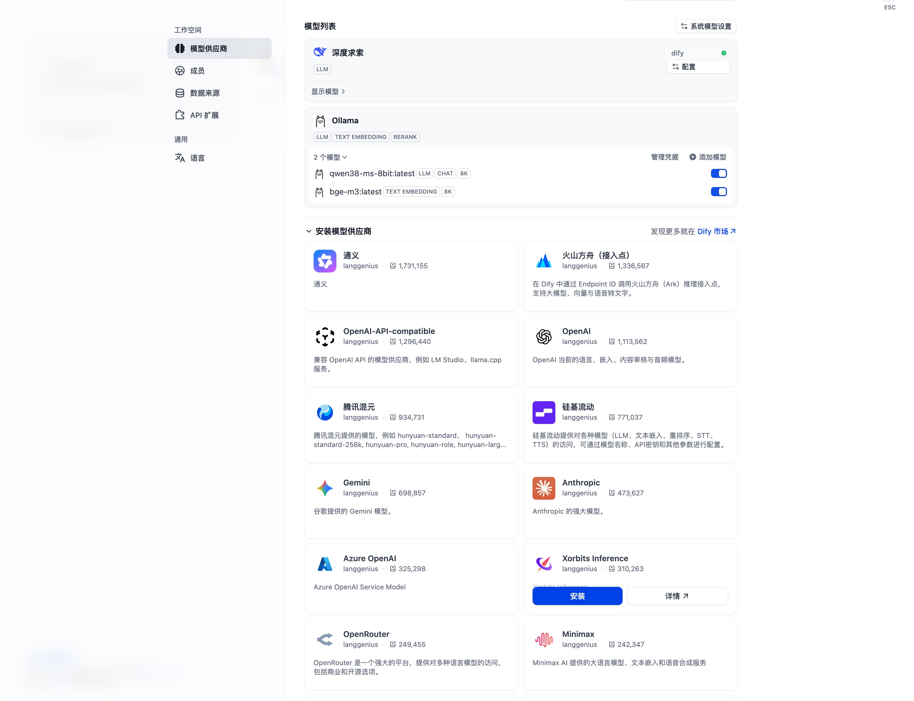

# 本地生成模型接入

## 目的与职责

在 Dify 中使用现有 Ollama 服务提供生成能力，不另建模型运行时。`bge-m3:latest` 负责问题与资料的向量化，`qwen38-ms-8bit:latest` 负责依据检索资料组织中文回答；两者是不同模型，共用同一个 Ollama 服务。

## 2026-10-15 实际配置

先通过本机 `/api/tags` 核对已安装模型，再选择已安装的 `qwen38-ms-8bit:latest` 进行中文文本生成验证，无需下载。模型别名不能单独证明上游身份，复现实验以本轮配置记录内的 Ollama 模型 digest 为准。

Dify 页面操作：右上角头像 → 设置 → 模型供应商 → Ollama → 添加模型。

| 项目 | 本轮值 |
|---|---|
| 模型名称 | `qwen38-ms-8bit:latest` |
| 模型类型／调用模式 | LLM／对话 |
| 基础 URL | `http://host.docker.internal:11434` |
| API 密钥 | 留空，现有本机 Ollama 无鉴权 |
| 上下文／最大输出上限 | 8192／1024 tokens，为本轮配置值，不是模型理论能力上限 |
| Vision／函数调用 | 本轮文本问答不启用，不据此判断模型原生能力 |

宿主机脚本访问 `http://localhost:11434`；Dify 在 Docker 内运行，使用 `host.docker.internal` 访问宿主机。不要将 Docker 容器内的 `localhost` 当作 Mac 的服务地址。

[模型添加表单截图](screenshots/20261015-local-llm-config.png)

添加后弹窗关闭，模型列表显示 `qwen38-ms-8bit:latest`，标识 `LLM CHAT 8K`，开关为启用；原有 `bge-m3:latest` 仍显示 `TEXT EMBEDDING 8K`。本轮没有修改系统默认模型、创建问答应用或修改知识库检索配置。

## 真实生成验证与证据

直接调用本机 Ollama `POST /api/chat`，提供资料“栈是一种遵循先入后出逻辑的线性数据结构”，提问“后放进去的东西先取出来，这叫什么结构？请只用一句话回答”。模型输出：

> 这叫做栈。

响应 `done=true`，`done_reason=stop`，输出 4 tokens，客户端端到端耗时约 32.42 秒。该耗时包含请求过程，未拆分模型加载；不能作为稳定吞吐或正式问答延迟指标。

运行证据目录：[local-generation-20261015-174104](../runs/local-generation-20261015-174104/)，包含 `config.json`（Provider 版本、模型 digest、Prompt/测试版本）、`request.json`、`response.json` 和 `summary.json`。本次是一次性接入检查，不新增批量问答评分脚本。

直接请求参数：`think=false`、`temperature=0`、`num_ctx=8192`、`num_predict=256`，非流式。Dify 表单的最大输出上限为 1024，与直接调用的 256 不同；表单本身未设置应用级思考模式和采样参数，创建应用时需要另行核对，不能认定两条链路的生成参数完全一致。

结论：本机真实生成调用成功，单题回答符合给定资料；Dify 模型添加并启用成功。尚未在 Dify 应用里执行真实问答，因此不声称 Dify 完整生成链路、引用、拒答或完整 RAG 效果通过。

下一步创建最小知识库问答应用，明确使用此模型和当前知识库，在应用中显式配置混合检索 0.7/0.3、Top K=3，再检查此前四题的回答、引用和无答案处理。

## 后续进展

已在 Dify 编排页使用本地模型完成 S01 真实问答并核查来源；应用编辑配置尚未发布保存。详见 [问答应用配置与验证](Dify问答应用配置与验证.md)，以上“尚未执行”结论为接入检查当时状态。
